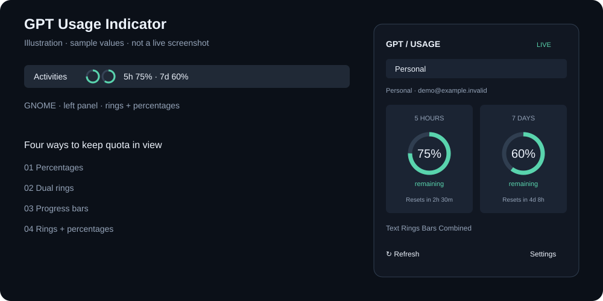

# GPT Usage Indicator

在 GNOME 顶栏左上角、Windows 或 macOS 小窗口中，持续查看指定 ChatGPT 账号的 **Codex 订阅额度**：5 小时与 7 天两个窗口。

支持百分比、双环、进度条、环图 + 数字四种视图，切换剩余／已用比例、多账号、自动刷新、重置时间。采用参考项目 [Agent Status Indicator](https://github.com/Ruochen0513/agent-status-indicator) 的“本地数据层 + 原生顶栏 + 跨平台小窗口”思路，额度协议与界面在本项目重新实现。



> **额度范围**：此项目展示 Codex 官方 `account/rateLimits/read` 返回的订阅额度。ChatGPT 网页端各模型的消息次数、API 余额和 API token 消费不属于本项目的数据源。5 小时／7 天窗口仅在账号接口确实返回相应时长时显示；未提供的数据用 `—` 表示。

## 平台与依赖

| 平台 | 实现 | 运行依赖 | 验证状态 |
| --- | --- | --- | --- |
| GNOME 46–50 | 左侧原生 Shell 插件 | Python 3.10+、Codex CLI | Schema、打包、JS 语法与逻辑已测；实机加载待验 |
| Windows | Tk 小窗口，`.cmd` / PowerShell 启动 | Python 3.10+（含 Tcl/Tk）、Codex CLI | 共享逻辑与 Windows 路径解析已测；原生运行待验 |
| macOS | Tk 小窗口，`.command` / Shell 启动 | Python 3.10+（含 Tcl/Tk）、Codex CLI | 共享逻辑已测；原生运行待验 |
| 其他 Linux 桌面 | 同一 Tk 小窗口 | Python 3.10+、Tkinter、Codex CLI | 无图形环境下的逻辑测试通过 |

运行核心不需要第三方 Python 包。安装 Codex CLI 并使用 ChatGPT 订阅登录；API key 登录不能提供这类订阅额度。安装方法见 [Codex CLI 官方文档](https://developers.openai.com/codex/cli/)。构建 GNOME ZIP 额外需要 `glib-compile-schemas`；Node.js 只用于开发时验证 JS。

## 快速开始：创建指定账号

以下命令都从**本项目根目录**执行，不需要安装 Python 包。

Linux / macOS：

```bash
python3 -B bin/run.py account add personal --label "个人账号" --email "you@example.com"
python3 -B bin/run.py login --account personal
python3 -B bin/run.py refresh --account personal
python3 -B bin/run.py show --account personal
```

Windows PowerShell：

```powershell
py -3 -B bin\run.py account add personal --label "个人账号" --email "you@example.com"
py -3 -B bin\run.py login --account personal
py -3 -B bin\run.py refresh --account personal
py -3 -B bin\run.py show --account personal
```

将 `you@example.com` 换成真实 ChatGPT 邮箱。`--email` 可省略；配置后每次刷新都核对登录邮箱，防止登录到其他账号。登录由 Codex 官方流程处理，密码无需交给本项目。

没有可用浏览器回调时，可以尝试设备授权：

```bash
python3 -B bin/run.py login --account personal --device-auth
```

设备授权是否可用取决于账号／组织策略。失败时使用普通 `login`。参见 [Codex 身份认证](https://developers.openai.com/codex/auth/)。

**已有 Codex 登录不会自动导入**：每个 profile 使用项目内部独立的 `CODEX_HOME`，并明确使用文件凭据存储。需要为本项目登录一次。即使使用系统里的 Codex 进行日常工作，额度仍是账号共享的，查询本项目的同一账号即可看到该账号额度。

## GNOME 插件

### 构建与安装

在 GNOME 主机上执行：

```bash
python3 -B scripts/package_extension.py
gnome-extensions install --force dist/gpt-usage@local.shell-extension.zip
```

安装后按桌面提示重新登录，再启用：

```bash
gnome-extensions enable gpt-usage@local
gnome-extensions prefs gpt-usage@local
```

Wayland 通常需要退出当前桌面会话再登录。安装／启用是用户在目标机器执行的部署步骤；开发过程中未修改宿主桌面或系统扩展目录。无需 root。

### 连接账号

在插件 Preferences 中设置：

| 设置 | 建议值 |
| --- | --- |
| Account profile id | `personal`，与 CLI 创建的 id 一致 |
| Absolute data directory | 本项目下 `.runtime` 的**绝对路径** |
| Codex executable | `codex`，或原生 Codex 可执行文件的绝对路径 |
| Python executable | `python3`，或 Python 3.10+ 的绝对路径 |
| Presentation | Percentages / Dual rings / Progress bars / Rings + percentages |
| Show remaining quota | 开启：剩余百分比；关闭：已用百分比 |
| Refresh interval | 30–3600 秒，默认 120 秒 |

例如本次开发目录的 data directory 是：

```text
/home/yuhaozhang/code/project/OpenSource/show_usage_of_gpt/.runtime
```

**路径输入后点击行内 Apply 按钮**。GNOME 从登录时的环境寻找命令，未必能看到终端中 nvm、venv 等设置的 PATH，遇到找不到命令时使用绝对路径。

留空 data directory 时使用已安装扩展的 `runtime` 子目录，它与源码 CLI 的 `.runtime` 不同。建议显式设置项目的 `.runtime`，并保持其路径稳定，以免重装扩展时丢失配置。扩展 ZIP 已包含 Python 后端，运行时不依赖源码目录；账号数据目录可以独立放置。

### 顶栏操作

- 插件通过 GNOME panel 的 `left` 区域插入，显示在左侧。
- 两个图形按 **5h、7d** 顺序排列；点击查看数值、账号、最后更新时间与重置时刻。
- 菜单中可以切换已创建的账号、立即刷新、打开设置。
- 插件启用后会立即刷新，之后定期刷新。查询异步执行，不阻塞 Shell。
- 禁用插件会清理定时器、设置监听及当前查询子进程。

## Windows 小窗口

先按“快速开始”登录账号，再运行：

```powershell
.\bin\gpt-usage-desktop.cmd
# 或
powershell -ExecutionPolicy Bypass -File .\scripts\start-windows.ps1
# 或
py -3 -B bin\run.py desktop
```

默认从 PATH 找 Codex。Windows 的常见 npm `.cmd` 包装器会被解析到安装包内的原生 `codex.exe`；不会通过 shell 执行包装器。自定义包管理器布局无法识别时，显式提供原生文件路径：

```powershell
py -3 -B bin\run.py --codex 'C:\Tools\Codex\codex.exe' login --account personal
py -3 -B bin\run.py --codex 'C:\Tools\Codex\codex.exe' desktop
```

在可写目录中使用便携版，避免放进受保护的 Program Files 目录。未打包的源码版依赖 `py -3` 和 Tkinter。

## macOS 小窗口

登录后启动：

```bash
bash scripts/start-macos.sh
# 或
bash bin/GPT-Usage.command
# 或
python3 -B bin/run.py desktop
```

源码仓库保留了 `.command` 的可执行权限，可以在 Finder 中打开。下载的 ZIP 若没有保留权限：

```bash
chmod +x bin/GPT-Usage.command
```

如果出现缺少 `_tkinter`，需要使用包含 Tcl/Tk 的 Python 发行版。可先检查：

```bash
python3 -c 'import tkinter; print(tkinter.TkVersion)'
```

## 小窗口操作

- 顶部选择账号；显示 label 与已核对的邮箱。
- 拖动标题 `GPT / USAGE` 或系统标题栏移动窗口。
- `Remaining / Used` 切换剩余／已用百分比。
- `Text / Rings / Bars / Combined` 切换视图。
- `Refresh` 手动刷新；自动刷新默认每 120 秒一次。
- `Settings` 设置置顶、透明度、刷新间隔，或新增账号 profile；登录仍在终端中完成。
- 位置、视图、账号、透明度和置顶选项保存在 `desktop.json`，下次启动恢复。
- 关闭窗口会取消在途请求，等待后端清理后退出；不常驻系统托盘。

## 多账号与 CLI

```bash
python3 -B bin/run.py account add work --label "工作账号" --email "work@example.com"
python3 -B bin/run.py login --account work
python3 -B bin/run.py account list
python3 -B bin/run.py refresh --account work
```

每个 profile 都有自己的登录目录与快照，UI 切换账号时立即清除旧账号显示，并忽略上一个账号的异步界面更新。

自定义数据目录与 Codex 路径必须放在子命令前：

```bash
python3 -B bin/run.py --data-dir "/absolute/path/to/private-data" --codex "/absolute/path/to/codex" refresh --account work
```

| 命令 | 功能 |
| --- | --- |
| `account add ID --label LABEL --email EMAIL` | 创建 profile，邮箱可选 |
| `account list` | 列出 profile；不显示凭据 |
| `login --account ID [--device-auth]` | 在该 profile 的隔离目录登录 |
| `refresh --account ID` | 查询官方接口并原子写入快照，输出 JSON |
| `show --account ID` | 只读取本地快照 |
| `desktop` | 启动跨平台窗口 |

退出码：`0` 成功；`1` 查询失败但已写入错误快照；`2` 参数后的配置／本地操作错误。profile id 支持 1–48 位字母、数字、`_`、`-`，不允许目录穿越字符。`--limit-id` 可以选择其他服务端分组，默认 `codex`；只有 300 分钟与 10080 分钟的窗口会映射到此 UI。

## 百分比、颜色与过期语义

| 情况 | 显示 |
| --- | --- |
| `usedPercent = 25`，显示剩余 | `75%` |
| `usedPercent = 25`，显示已用 | `25%` |
| 接口缺失／不支持该窗口 | `—`，不补成 0% |
| 距上次成功查询超过 `max(600, 2 × 刷新间隔 + 120)` 秒 | STALE，隐藏旧数值 |
| 已到服务端提供的重置时间 | `—`，等待新的查询确认 |
| 网络／登录／身份校验失败 | OFFLINE 或 Unavailable，显示错误原因，清空旧额度 |

颜色始终按**剩余额度**判断，即使当前显示已用比例：大于 25% 为绿色，10–25% 为黄色，10% 及以下为红色。未知为灰色。环图从 12 点方向顺时针增长；已用模式增长表示消耗，剩余模式增长表示可用。

不会把重置后的额度推算为满额，也不会把主／次窗口的位置硬编码成 5 小时／7 天，而是依据服务端 `windowDurationMins` 匹配。多分组接口优先，并且不会把不同分组的额度拼在一起。

## 文件、凭据与网络

源码版默认将**所有本项目数据**放在项目下的 `.runtime/`：

```text
.runtime/
  accounts.json                         # profile 标签、预期邮箱、额度分组
  accounts/<id>/codex-home/              # 隔离的 Codex 配置和登录凭据
  snapshots/<id>.json                    # 无 token 的额度快照
  desktop.json                          # 小窗口偏好
```

原生可执行程序默认在可执行文件旁创建 `.runtime`；macOS `.app` 使用应用包旁的 `.runtime`，与同目录的 CLI 共用。用 `--data-dir` 可覆盖默认位置。若将软件或凭据目录移到不可信设备，应重新登录并按需撤销相关会话。

- `.runtime` 被 Git 忽略；打包采用明确的源码目录列表，不包含凭据或开发运行数据。
- JSON 使用临时文件 + 原子替换；POSIX 新建私有目录为 `0700`、JSON 为 `0600`。Windows 依赖当前用户目录的 ACL。
- 明确设置 `cli_auth_credentials_store="file"`，避免多个 profile 误用系统钥匙串中的共用登录。
- 后端不自行解析或输出 access token，也不读取聊天记录。快照包含账号邮箱，仍属于私人数据。
- 额度查询由 Codex CLI 联系官方服务；界面只读本地快照。需要网络，错误诊断不会原样记录服务端响应正文。
- 只使用初始化与账号读取接口，不创建模型会话／turn，不为了测额度发送推理请求。
- 无全局安装脚本、后台系统服务、注册表修改或自动设置开机启动；如需登录自启，可自行将启动器加入对应平台的登录项。
- 配置界面与 CLI 应避免同时编辑账号列表。请勿在刷新或登录过程中手工修改同一个 profile 的凭据。

## 构建发行包

### GNOME ZIP

```bash
python3 -B scripts/package_extension.py
```

输出 `dist/gpt-usage@local.shell-extension.zip`，包含 GJS 界面、严格编译的 GSettings schema 和标准库 Python 后端。

### 跨平台源码便携包

```bash
python3 -B scripts/package_desktop.py
```

输出 `dist/gpt-usage-desktop-portable.zip`。解压后按对应平台启动；仍需本机 Python、Tk 与 Codex CLI。此包不是已签名的原生安装程序。

### 独立桌面可执行程序

需要在**目标操作系统上**构建；不支持从 Linux 直接交叉编译出 Windows/macOS 应用。

Linux / macOS：

```bash
python3 -m venv .venv
.venv/bin/python -m pip install --no-cache-dir 'pyinstaller>=6.11,<7'
.venv/bin/python -B scripts/build_desktop.py
```

Windows：

```powershell
py -3 -m venv .venv
.\.venv\Scripts\python.exe -m pip install --no-cache-dir 'pyinstaller>=6.11,<7'
.\.venv\Scripts\python.exe -B scripts\build_desktop.py
```

产物位于 `dist/desktop/`，包括控制台 `gpt-usage` 与窗口版 `gpt-usage-desktop`，macOS 还会生成 `.app`。独立版不需要额外安装 Python，但仍需要 Codex CLI。先用同目录的控制台程序创建 profile、登录，再打开窗口版。构建未配置签名／公证，系统可能提示未知发布者。

仓库提供 `.github/workflows/check.yml`，在 Ubuntu、Windows、macOS 上运行测试并构建独立版。工作流未在本次本地开发中实际触发，不能将其视为已经通过的跨平台测试结果。

## 开发与验证

```bash
python3 -B -m unittest discover -s tests -v
node tests/test_ui.mjs
node --input-type=module --check < gnome-extension/gpt-usage@local/extension.js
node --input-type=module --check < gnome-extension/gpt-usage@local/prefs.js
bash -n bin/gpt-usage bin/GPT-Usage.command scripts/start-macos.sh
python3 -B scripts/package_extension.py
python3 -B scripts/package_desktop.py
git diff --check
```

测试只使用项目 `.runtime/tests` 中的临时目录与本地模拟 app-server，不读取真实账号、不会联网查询额度。图形测试需要可连接的 Tk display；没有显示服务时明确跳过。GNOME 打包测试在没有 `glib-compile-schemas` 的平台跳过。

本次本地验证的完整记录与限制见 [最终自查](docs/reviews/final.md)，GNOME 先行自查见 [GNOME 审查](docs/reviews/gnome.md)。实机验收步骤见 [手工验收清单](docs/ACCEPTANCE.md)。

## 故障排查

| 现象 | 检查 |
| --- | --- |
| 一直 `—` | 运行 `refresh --account ID`，查看错误；核对 profile 与 data directory |
| `login_required` | 为该 profile 执行 ChatGPT `login`，不要使用 API key 模式 |
| `account_mismatch` | 重新登录预期邮箱，或修正 `accounts.json` 中的预期邮箱 |
| `cli_missing` / `cli_wrapper` | 用 `--codex` 或 GNOME 设置填写原生二进制绝对路径 |
| `unsupported_limits` | 服务未返回该分组，或 CLI 不支持此额度接口；更新 CLI 后重试 |
| `timeout` / `server_error` | 检查网络、订阅登录状态，稍后手动刷新；服务端原文为隐私起见不输出 |
| 顶栏找不到账号 | 设置的路径必须与创建 profile 的 CLI `--data-dir` 一致 |
| GNOME 无法启动后端 | 核对 Python 3.10+ 与 Codex 的绝对路径，确认 ZIP 内有 backend |
| 只有一个窗口有数值 | 账号服务只提供了一个已识别时长的窗口，另一个保持未知 |
| 缺少 Tkinter / `_tkinter` | 为当前 Python 安装匹配的 Tcl/Tk，或使用包含 Tk 的发行版 |
| Linux 上 `couldn't connect to display` | 从图形会话启动桌面窗口；无界面环境仍可使用 CLI |

GNOME 状态查询：

```bash
gnome-extensions info gpt-usage@local
```

### 卸载

关闭小窗口即可停止运行。GNOME 先执行：

```bash
gnome-extensions disable gpt-usage@local
gnome-extensions uninstall gpt-usage@local
```

随后按需删除解压目录／原生应用。账号数据不会由卸载命令自动删除；确认不再需要后自行删除 `.runtime` 或自定义数据目录，这会删除本项目的登录凭据和设置。其他 Codex 客户端配置不在本项目管理范围内。

## 项目结构

```text
gpt_usage/         账号、存储、JSONL provider、CLI、Tk 窗口
bin/               便携 CLI / Windows / macOS 启动入口
gnome-extension/   GNOME Shell 插件、设置页、纯展示逻辑、schema
scripts/           GNOME / 便携包 / 原生构建、平台启动脚本
tests/             配额、隔离、取消、协议、打包、展示与 GUI 测试
docs/              方案、示意图、审查与手工验收记录
.github/workflows/ 三平台测试和构建流程
```

## 技术参考与许可

- [Codex App Server 官方协议](https://developers.openai.com/codex/app-server/)：初始化、`account/read`、`account/rateLimits/read` 与分组／窗口字段。
- [Codex 身份认证](https://developers.openai.com/codex/auth/)：ChatGPT 登录、设备授权与凭据存储。
- [GNOME 扩展 API](https://gjs.guide/extensions/topics/extension.html)、[Preferences](https://gjs.guide/extensions/development/preferences.html)、[异步子进程](https://gjs.guide/guides/gio/subprocesses.html)。
- [Codex npm 启动器源码](https://github.com/openai/codex/blob/main/codex-cli/bin/codex.js)：平台原生可执行文件布局参考。
- [Agent Status Indicator](https://github.com/Ruochen0513/agent-status-indicator)：架构与跨平台呈现方式参考；本项目未修改参考仓库。

MIT，见 [LICENSE](LICENSE)。本项目不是 OpenAI 官方产品。
